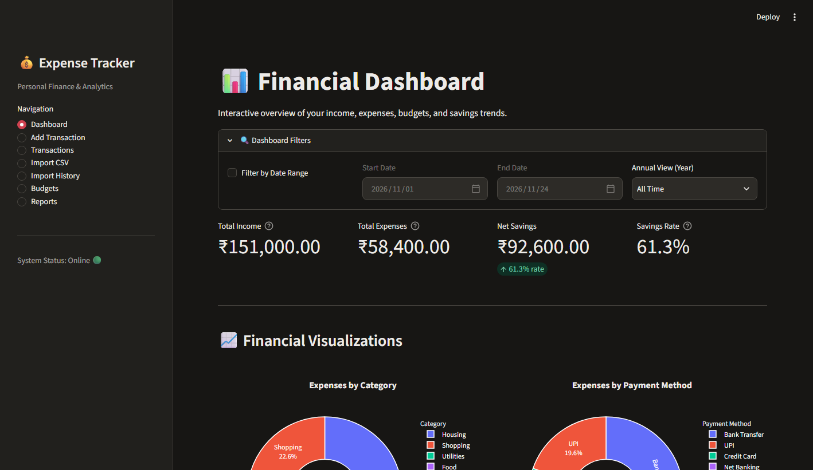
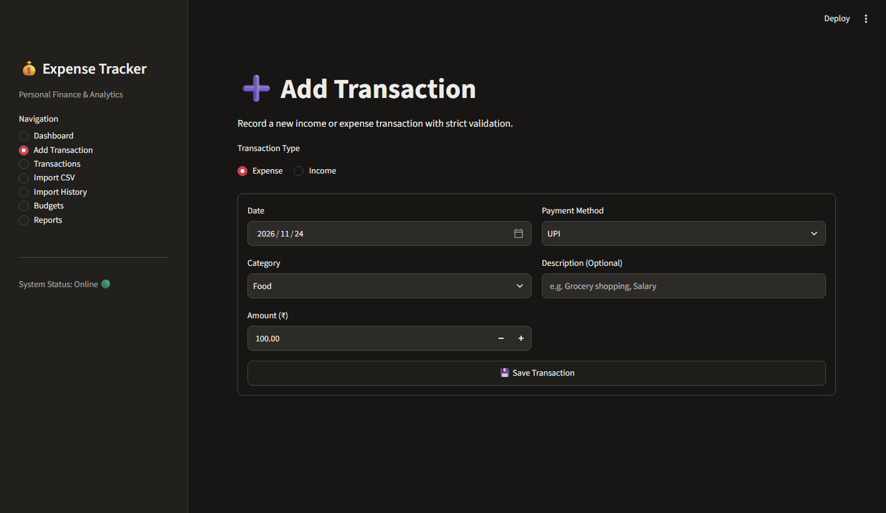
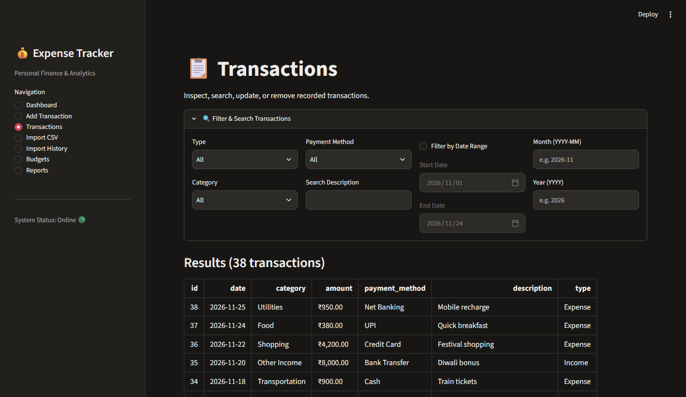
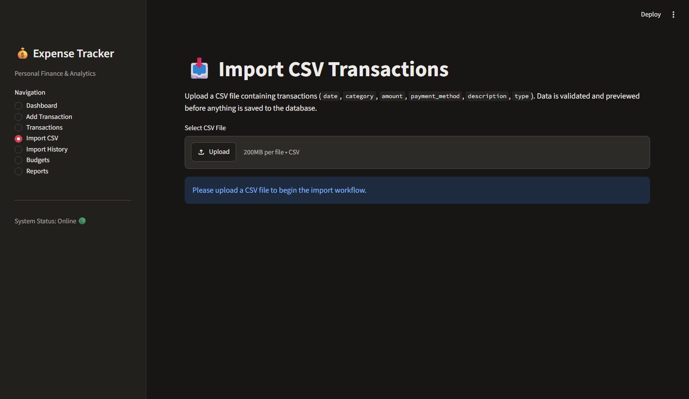
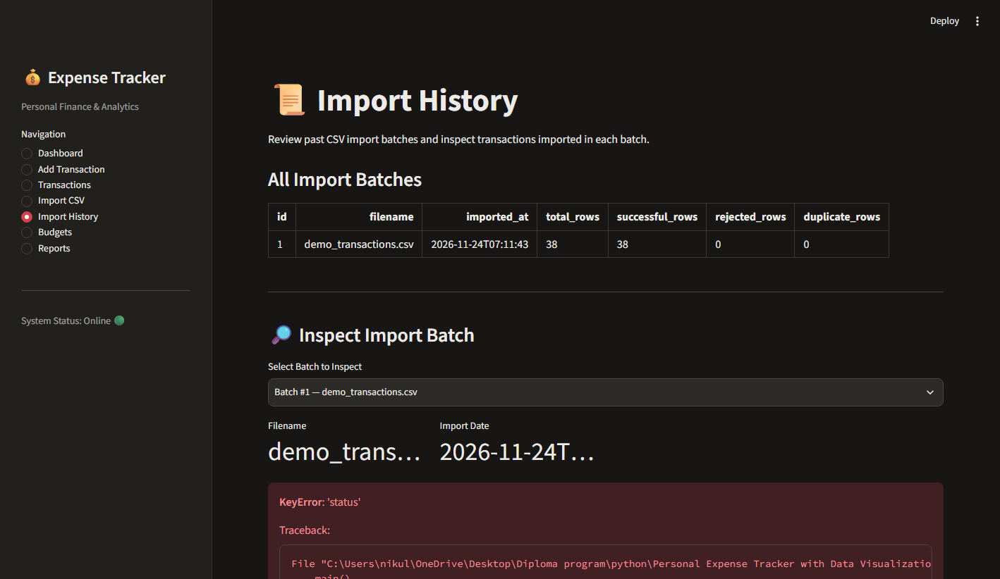
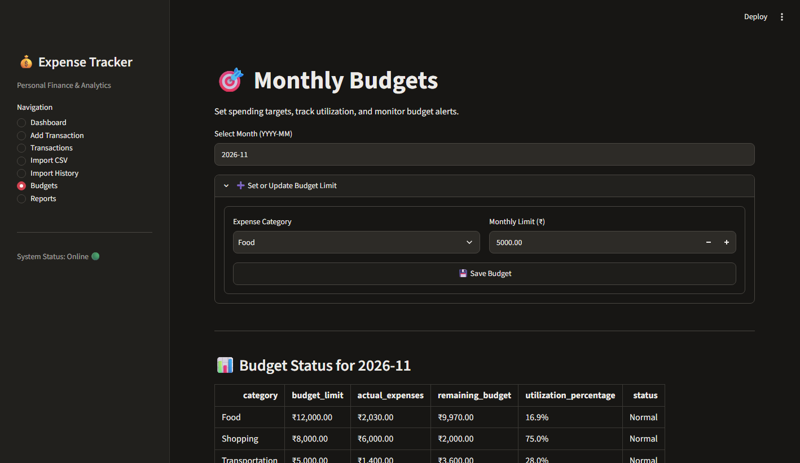
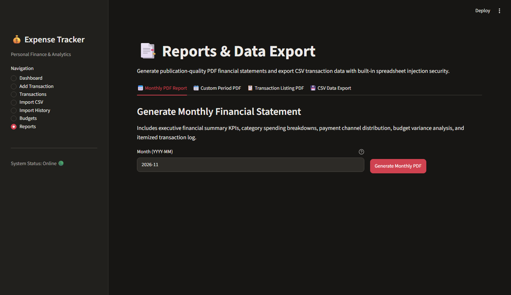
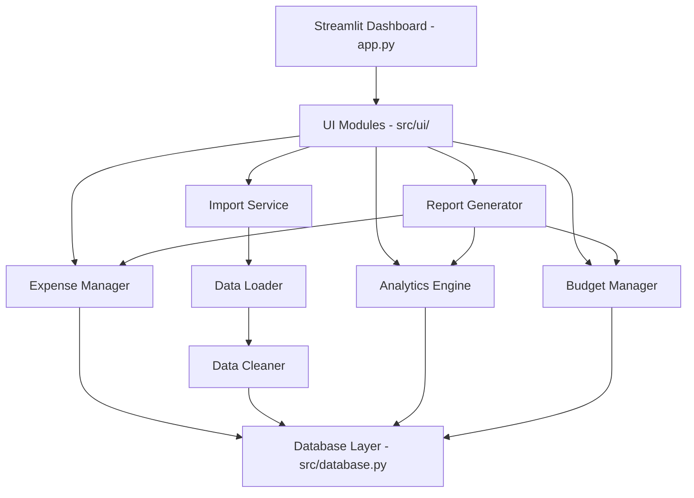

# 💰 Personal Expense Tracker with Data Visualization

A comprehensive Python-based personal finance management application that enables users to track income and expenses, set category budgets, analyse spending patterns through interactive charts, and generate professional PDF financial reports — all powered by a local SQLite database and a Streamlit web dashboard.

---

## 📋 Problem Statement

Managing personal finances manually using spreadsheets or notebooks is error-prone, difficult to maintain, and lacks analytical capabilities. Individuals need a simple, offline-capable tool to:

- Record daily income and expenses with proper categorisation.
- Monitor spending against monthly budget targets.
- Visualise financial trends across months and categories.
- Generate downloadable reports for personal records.

---

## 🎯 Project Objectives

1. Build a complete CRUD system for financial transactions (Income & Expense).
2. Implement validated CSV data import with duplicate detection and batch tracking.
3. Provide real-time financial analytics (totals, breakdowns, trends, comparisons).
4. Create interactive data visualisations using Plotly.
5. Enable monthly budget management with utilisation tracking and breach alerts.
6. Generate professional A4 PDF financial reports using ReportLab.
7. Export sanitised CSV data with spreadsheet formula injection protection.
8. Deliver a user-friendly Streamlit web interface.

---

## ✨ Implemented Features

### Transaction Management
- Add, edit, and delete Income and Expense transactions.
- Strict date validation (calendar-aware), positive amount enforcement.
- Category-type matching (Expense categories for expenses, Income categories for income).
- Filter and search transactions by type, category, payment method, date range, month, year, and description.

### CSV Import Pipeline
- Load CSV files with UTF-8 and UTF-8-BOM encoding support.
- Case-insensitive column name matching with whitespace tolerance.
- Row-by-row validation with detailed rejection reasons.
- Conservative duplicate detection (within-CSV and against database).
- Batch audit logging with import history inspection.
- Export rejected and duplicate rows for review.

### Financial Analytics
- Financial overview: total income, total expenses, net savings, savings rate.
- Category-wise expense breakdown with percentage shares.
- Monthly summary with income, expenses, and net savings.
- Payment method distribution analysis.
- Month-over-month comparison with percentage changes.
- Average, highest, and lowest transaction analytics.

### Budget Management
- Set monthly per-category budget limits (Expense categories only).
- Upsert support: creating or updating budgets idempotently.
- Budget utilisation tracking with status classification:
  - 🟢 **Normal** (< 80%)
  - 🟡 **Warning** (80–100%)
  - 🔴 **Exceeded** (> 100%)
- Budget deletion without affecting transaction history.

### Interactive Visualisations (Plotly)
- 🍩 Category expense donut chart.
- 📊 Monthly income vs expense grouped bar chart.
- 📈 Monthly expense trend line chart with markers.
- 🍩 Payment method distribution donut chart.
- 📊 Budget utilisation horizontal bar chart with 80% and 100% threshold lines.
- 📊 Monthly net savings bar chart with positive/negative colour coding.

### PDF Reports (ReportLab)
- **Monthly Financial Statement**: Executive summary KPIs, category breakdowns, payment method distribution, budget performance, itemised transaction log.
- **Custom Period Report**: Arbitrary date range financial analysis.
- **Transaction Listing Report**: Filtered, paginated transaction detail PDF.
- Professional styling with page numbers ("Page X of Y"), headers, and footers.

### CSV Export
- Export filtered or all transactions to CSV.
- UTF-8 with BOM encoding for Excel compatibility.
- Spreadsheet formula injection protection: values starting with `=`, `+`, `-`, `@`, Tab, or CR are prefixed with `'` in the export only (database records remain untouched).

### Streamlit Web Dashboard
- 7-page navigation: Dashboard, Add Transaction, Transactions, Import CSV, Import History, Budgets, Reports.
- Responsive layout with Plotly chart integration.
- Graceful handling of empty states across all pages.
- Download buttons for PDF and CSV exports.
- Fallback HTML table rendering when `pyarrow` is unavailable (Windows ARM64).

---

## 📸 Application Screenshots

The application provides a clean, responsive dark-themed user interface across 7 dedicated functional views (captured using the included synthetic demonstration dataset):

| 1. Financial Overview Dashboard | 2. Add Transaction Entry |
|:---:|:---:|
|  |  |
| **3. Transactions Management & Filters** | **4. CSV Import & Preview** |
|  |  |
| **5. Batch Import History & Audit** | **6. Budget Utilization & Alert Gauges** |
|  |  |
| **7. Financial Reports (PDF) & Exports (CSV)** | |
|  | *(All data shown is 100% synthetic)* |

---

## 📚 Technical Documentation & Guides

For deeper technical and implementation details, refer to the accompanying documentation:
- 🏛️ **[System Architecture & Data Flow](docs/02_ARCHITECTURE.md)**: Detailed breakdown of the 5-layer pipeline, ER diagrams, and module responsibilities.
- 🚀 **[Demonstration & Walkthrough Guide](docs/DEMO_GUIDE.md)**: Step-by-step instructions for running demonstrations with sample data.
- 🎓 **[Placement & Portfolio Project Guide](docs/PLACEMENT_PROJECT_GUIDE.md)**: 30-second and 2-minute project pitch, design decisions, security architecture, and 20 technical interview Q&As.
- 📝 **[Session 11 Hardening Changelog](docs/11_CHANGELOG.md)**: Detailed changelog of final codebase hardening and test additions.

---

## 🛠️ Technology Stack

| Layer | Technology |
|-------|------------|
| Language | Python 3.12+ |
| Database | SQLite 3 (built-in `sqlite3`) |
| Data Processing | Pandas, NumPy |
| Visualisation | Plotly |
| Web Dashboard | Streamlit |
| PDF Reports | ReportLab |
| PDF Testing | pypdf |
| Testing | pytest |

---

## 🏗️ Project Architecture



### Module Dependency Chain
```
app.py
 └── src/ui/ (dashboard, add_transaction, transactions, import_csv, import_history, budgets, reports)
      ├── src/expense_manager.py      ← Transaction CRUD
      ├── src/import_service.py       ← CSV import pipeline
      │    ├── src/data_loader.py     ← CSV file reading
      │    └── src/data_cleaner.py    ← Validation & deduplication
      ├── src/analytics.py            ← Financial computations
      ├── src/budget_manager.py       ← Budget CRUD & status
      ├── src/visualizations.py       ← Plotly chart generation
      ├── src/report_generator.py     ← PDF & CSV export
      └── src/database.py            ← SQLite schema, connections, triggers
```

---

## 📁 Folder Structure

```
Personal Expense Tracker with Data Visualization/
├── app.py                    ← Streamlit entry point
├── main.py                   ← Legacy launcher (redirects to app.py)
├── requirements.txt          ← Python dependencies
├── README.md                 ← This file
├── .gitignore
├── .streamlit/
│   └── config.toml           ← Streamlit theme configuration
├── data/
│   ├── expense_tracker.db    ← Production SQLite database (auto-created)
│   ├── raw/                  ← User-uploaded CSV files
│   ├── processed/            ← Cleaned data outputs
│   └── sample/
│       └── demo_transactions.csv  ← Synthetic demo dataset (38 records)
├── docs/                     ← Technical documentation & changelogs
├── images/                   ← Screenshots and diagrams
├── outputs/
│   ├── charts/               ← Saved chart images
│   └── exports/              ← CSV exports
├── reports/
│   └── monthly_reports/      ← Generated PDF reports
├── src/
│   ├── __init__.py
│   ├── database.py           ← Schema, migrations, triggers, connections
│   ├── data_loader.py        ← CSV loading and column validation
│   ├── data_cleaner.py       ← Row validation, deduplication, CleaningResult
│   ├── expense_manager.py    ← Transaction CRUD operations
│   ├── import_service.py     ← Import pipeline, batch logging, history
│   ├── analytics.py          ← Financial analytics computations
│   ├── budget_manager.py     ← Budget CRUD and utilisation status
│   ├── visualizations.py     ← Plotly chart generation
│   ├── report_generator.py   ← PDF reports and CSV export
│   └── ui/
│       ├── __init__.py
│       ├── common.py         ← Shared helpers (formatting, categories, rendering)
│       ├── dashboard.py      ← Dashboard page
│       ├── add_transaction.py← Add Transaction page
│       ├── transactions.py   ← Transactions management page
│       ├── import_csv.py     ← CSV import page
│       ├── import_history.py ← Import history page
│       ├── budgets.py        ← Budget management page
│       └── reports.py        ← Reports & export page
└── tests/
    ├── __init__.py
    ├── test_database.py         ← 34 tests
    ├── test_data_loader.py      ← 20 tests
    ├── test_data_cleaner.py     ← 24 tests
    ├── test_expense_manager.py  ← 40 tests
    ├── test_import_service.py   ← 32 tests
    ├── test_analytics.py        ← 26 tests
    ├── test_budget_manager.py   ← 32 tests
    ├── test_visualizations.py   ← 19 tests
    ├── test_report_generator.py ← 10 tests
    ├── test_csv_export.py       ← 10 tests
    ├── test_streamlit_app.py    ← 22 tests
    └── test_end_to_end.py       ← 20 tests (Total: 337 tests)
```

---

## 🚀 Setup Instructions

### 1. Clone the Repository
```bash
git clone https://github.com/your-username/personal-expense-tracker.git
cd "Personal Expense Tracker with Data Visualization"
```

### 2. Create a Virtual Environment (Windows)
```bash
python -m venv .venv
.venv\Scripts\activate
```

### 3. Install Dependencies
```bash
pip install -r requirements.txt
```

### 4. Launch the Application
```bash
streamlit run app.py
```

The database (`data/expense_tracker.db`) is automatically created and seeded with 8 default categories on first launch:

| Expense Categories | Income Categories |
|-------------------|-------------------|
| Food | Salary |
| Transportation | Other Income |
| Shopping | |
| Utilities | |
| Healthcare | |
| Housing | |

---

## 📖 Usage Guide

### Adding Transactions
1. Navigate to **Add Transaction** in the sidebar.
2. Select the transaction type (Income or Expense).
3. Choose a category, enter the amount, date, payment method, and description.
4. Click **Add Transaction** to save.

### Importing CSV Data
1. Navigate to **Import CSV**.
2. Upload a CSV file with the required columns: `date`, `category`, `amount`, `payment_method`, `description`, `type`.
3. Review the preview showing valid, rejected, and duplicate records.
4. Click **Confirm Import** to save valid transactions to the database.

A sample CSV file is provided at `data/sample/demo_transactions.csv` with 38 synthetic records spanning September–November 2026.

### Managing Budgets
1. Navigate to **Budgets**.
2. Select an Expense category and month (YYYY-MM).
3. Enter the budget limit and click **Set Budget**.
4. View the budget utilisation table with colour-coded statuses.

### Viewing Analytics
- The **Dashboard** shows financial KPIs, category breakdowns, and interactive Plotly charts.
- Charts update automatically based on selected date range and year filters.

### Generating Reports
1. Navigate to **Reports**.
2. Choose from:
   - **Monthly PDF Report**: Enter YYYY-MM, click Generate.
   - **Custom Period PDF**: Select start and end dates.
   - **Transaction Listing PDF**: Apply filters, generate filtered listing.
   - **CSV Export**: Download filtered or all transactions.

---

## 🧪 Running Tests

```bash
# Run all tests
python -m pytest tests/ -v --tb=short

# Run a specific test module
python -m pytest tests/test_analytics.py -v

# Run with coverage (if pytest-cov is installed)
python -m pytest tests/ --cov=src --cov-report=html
```

All tests use temporary databases (`tmp_path` fixtures) and never touch the production database.

---

## 🔒 Security Features

| Feature | Implementation |
|---------|---------------|
| SQL Injection Protection | All queries use parameterised SQL (`?` placeholders) |
| CSV Formula Injection | Export values starting with `=`, `+`, `-`, `@` are prefixed with `'` |
| HTML/XSS Protection | DataFrame rendering uses `escape=True` on `to_html()` |
| Foreign Key Enforcement | SQLite `PRAGMA foreign_keys = ON` on every connection |
| Date Validation | Calendar-aware validation rejects invalid dates like Feb 30 |
| Import Batch Accounting | Trigger enforces `total = successful + rejected + duplicate` |
| Duplicate Detection | Signature-based matching within CSV and against existing DB records |

---

## ⚠️ Known Limitations

1. **Single-user application**: No authentication or multi-user support.
2. **Local storage only**: Data stored in a local SQLite file — no cloud sync.
3. **No bank API integration**: Transactions must be entered manually or imported from CSV.
4. **No forecasting**: ARIMA/ML-based spending predictions are not implemented.
5. **No anomaly detection**: Isolation Forest or similar outlier detection is not implemented.
6. **PDF font limitation**: Indian Rupee symbol (₹) is rendered as `Rs.` in PDFs due to ReportLab standard font encoding limitations (₹ is used in the web UI).
7. **Windows ARM64**: `pyarrow` may not install; the app falls back to HTML table rendering automatically.

---

## 🔮 Future Improvements

- [ ] User authentication and role-based access.
- [ ] Cloud database support (PostgreSQL/MySQL).
- [ ] Bank statement import (OFX/QIF formats).
- [ ] Monthly spending forecasts using ARIMA.
- [ ] Anomaly detection for unusual transactions.
- [ ] Recurring transaction scheduling.
- [ ] Mobile-responsive PWA interface.
- [ ] Data backup and restore functionality.
- [ ] Multi-currency support.

---

## 📄 License

This repository is currently unlicensed for open-source publication pending selection (e.g., MIT, Apache 2.0, or GPLv3). See [GitHub Release Checklist & License Options](docs/PLACEMENT_PROJECT_GUIDE.md) for details.
