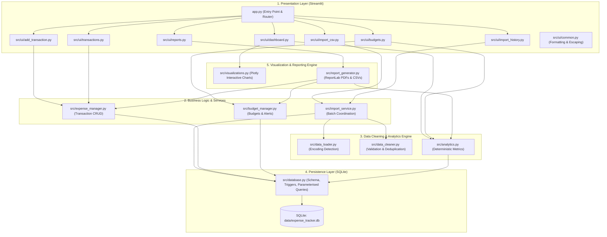
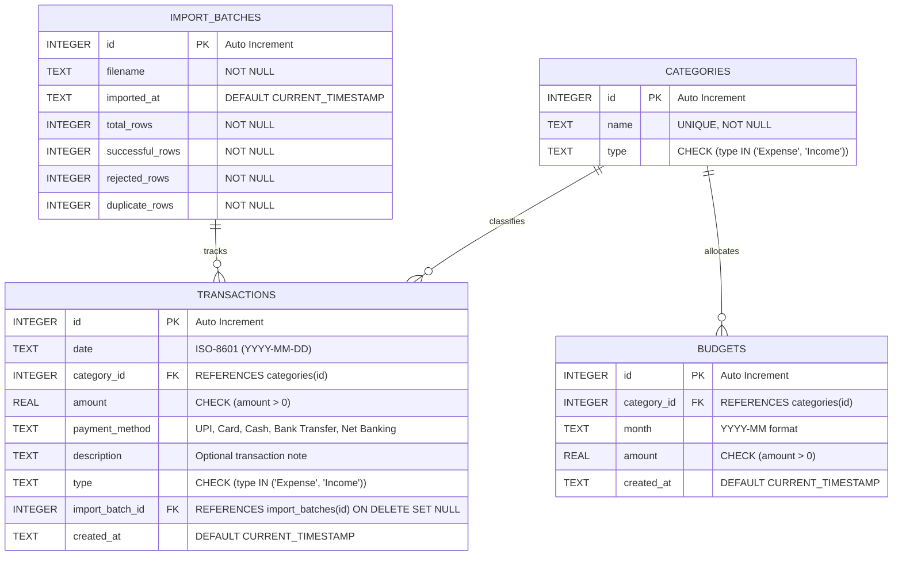

# 02 — System Architecture & Data Flow Reference

## Personal Expense Tracker with Data Visualization

---

## 1. Architectural Overview

The application is structured following a **Modular Layered Architecture** with strict unidirectional data flow and clean separation of concerns. All business logic, database queries, and reporting calculations remain decoupled from the Streamlit web presentation layer.



---

## 2. End-to-End Data Flow

The core application data flows through five defined operational stages:

```
Streamlit UI  ──►  Business Logic  ──►  Data Cleaning & Analytics  ──►  SQLite Database  ──►  Visualizations & Reports
```

1. **User Interaction & Input Capture (Streamlit UI):**
   - The user enters manual transactions, sets monthly budgets, applies multi-criteria filters, or uploads external CSV files.
   - Text rendering in the UI routes through `render_dataframe(escape=True)` in `common.py` to neutralize any Cross-Site Scripting (XSS) payload.
2. **Business Logic & Coordination:**
   - `expense_manager.py` enforces transaction integrity, positive numeric amounts, and valid ISO-8601 calendar dates (`YYYY-MM-DD`).
   - `budget_manager.py` verifies monthly format (`YYYY-MM`), enforces upsert semantics on `(category_id, month)`, and classifies spending against thresholds (`<80%` Normal, `80%–100%` Warning, `>100%` Exceeded).
   - `import_service.py` coordinates atomic two-phase CSV imports, ensuring a batch is never committed without explicit user confirmation.
3. **Data Ingestion, Cleaning & Deduplication:**
   - `data_loader.py` reads CSVs, detects encodings (`utf-8`, `utf-8-sig`, `latin-1`), and validates column schema.
   - `data_cleaner.py` strips whitespace, coerces numeric fields, maps categories case-insensitively, and identifies intra-file duplicates.
   - `analytics.py` executes deterministic financial metrics, KPI summaries, and month-over-month comparisons with zero-baseline handling (`None` percentage change when previous value is zero).
4. **Data Persistence (SQLite):**
   - All SQL operations in `database.py` use strictly parameterised queries (`?` placeholders).
   - SQLite foreign keys are explicitly enforced via `PRAGMA foreign_keys = ON;`.
   - Hardening triggers prevent deletion or modification of system categories and enforce transaction referential integrity.
5. **Visualization & Output Generation:**
   - `visualizations.py` transforms aggregated analytical DataFrames into 6 Plotly interactive charts with unified color palettes and empty-state error boundaries.
   - `report_generator.py` compiles multi-page publication-grade A4 financial statements using ReportLab's `NumberedCanvas` with font-safe currency (`Rs. {:,.2f}`) and exports formula-injection-sanitized CSV files.

---

## 3. Module Responsibilities Matrix

| Module | Architectural Role | Core Functions / Capabilities |
|--------|--------------------|-------------------------------|
| `app.py` | UI Router & Entry Point | Session configuration, database initialisation, sidebar radio navigation between all 7 modules, query-parameter deep linking. |
| `src/database.py` | Database Management | Connection lifecycle, schema creation, category seeding, foreign key enforcement, migration triggers, query helpers. |
| `src/data_loader.py` | File Ingestion | Robust CSV ingestion, fallback encoding detection, schema presence checks. |
| `src/data_cleaner.py` | Data Sanitization | Date validation, type casting, category matching, intra-batch and database duplicate candidate detection. |
| `src/import_service.py` | Batch Import Orchestrator | Two-phase import workflow (Preview → Confirmation), atomic SQLite transactions, batch row accounting, rejected row exporting. |
| `src/expense_manager.py` | Transaction Service | Manual transaction CRUD, multi-criteria filtering (date, category, type, payment method, keyword search), summary statistics. |
| `src/budget_manager.py` | Budget Service | Category monthly budget upserts, spending status calculations, threshold alert evaluation (`Normal`, `Warning`, `Exceeded`). |
| `src/analytics.py` | Financial Analytics Engine | KPI calculations (Income, Expense, Net Savings, Savings Rate), category breakdown, monthly trends, payment method share, MoM comparison. |
| `src/visualizations.py` | Charting Engine | Interactive Plotly charts (Category Donut, Monthly Income vs Expense, Trend Line, Payment Bar, Budget Utilization Gauge, Savings Variance). |
| `src/report_generator.py` | Reporting & Export Service | Executive PDF report compilation (Monthly Statement, Custom Range, Filtered Transaction Log), CSV formula injection sanitization (`=`, `+`, `-`, `@`, `\t`). |
| `src/ui/*.py` | Presentation Layer | 7 modular views (`dashboard`, `add_transaction`, `transactions`, `import_csv`, `import_history`, `budgets`, `reports`) + shared formatting. |

---

## 4. Database Schema & Entity Relationships

The relational model consists of four core tables managed inside SQLite with enforced foreign key cascades and triggers:



### Table Specifications:

1. **`categories`:**
   - Stores canonical expense and income categories.
   - Seeded with 8 system categories (6 Expense: *Food, Transportation, Shopping, Utilities, Healthcare, Housing*; 2 Income: *Salary, Other Income*).
   - Protected against unintended deletion via database triggers.
2. **`import_batches`:**
   - Audit trail for every CSV file uploaded.
   - Strict row accounting invariant: `total_rows == successful_rows + rejected_rows + duplicate_rows`.
3. **`transactions`:**
   - Central financial ledger.
   - Enforces referential integrity to `categories(id)`.
   - Links optionally to `import_batches(id)` with `ON DELETE SET NULL`.
   - Validates `amount > 0` and valid ISO-8601 dates.
4. **`budgets`:**
   - Stores category spending targets per calendar month (`YYYY-MM`).
   - Enforces unique constraint `UNIQUE(category_id, month)` to prevent duplicate allocations.
